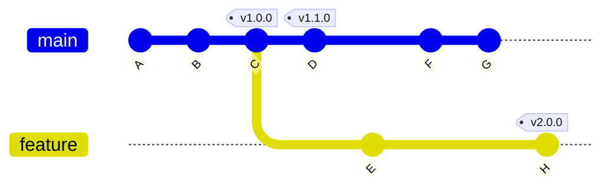

# gitver

[](https://github.com/MMauro94/gitver/blob/main/LICENSE)
[](http://kotlinlang.org)
[](https://central.sonatype.com/artifact/dev.mmauro/gitver)

A tiny and lightweight Gradle plugin for GIT tags-based semantic versioning.

This plugin provides an opinionated and easy-to-understand way to obtain version related information stored in your
repository GIT tags.

**Features:**

- Single source of truth of version in GIT tags (supports all GIT tags types)
- Get current version based on where `HEAD` is pointing at
- Handles `SNAPSHOT` versions by auto-incrementing last version (configurable)
- Supports multiple branches
- List all versions in the repository

## Quick start

In your `settings.gradle.kts` add:

```kotlin
pluginManagement {
    repositories {
        mavenCentral()
    }
}
```

In your `build.gradle.kts`:

```kotlin
plugins {
    id("dev.mmauro.gitver") version "..."
}

version = gitver.currentVersion.get()
```

See latest version in badge above or look directly
at [Maven Central page](https://central.sonatype.com/artifact/dev.mmauro/gitver).

This library uses [semantic versioning](https://semver.org/).

<details>

<summary>Using the SNAPSHOT build</summary>


Snapshot builds are published on every commit in `main`.

To use, add in your `settings.gradle.kts`:

```kotlin
pluginManagement {
    repositories {
        maven("https://central.sonatype.com/repository/maven-snapshots")
    }
}
```

See latest version in badge above or look
at [maven-metadata.xml](https://central.sonatype.com/repository/maven-snapshots/dev/mmauro/gitver/maven-metadata.xml).

</details>

## Overview

Imagine your GIT repository is in the following state:



Based on where `HEAD` points to, the plugin will provide the following values:

| What                            | `HEAD` @ `B`      | `HEAD` @ `D` | `HEAD` @ `E`      |
|---------------------------------|-------------------|--------------|-------------------|
| `currentVersion`                | `0.1.0-SNAPSHOT`¹ | `1.1.0`      | `1.0.1-SNAPSHOT`¹ |
| `lastTaggedVersion`             | _N/A_             | `1.1.0`      | `1.0.0`           |
| `commitsSinceLastTaggedVersion` | `[A]`             | `[]`         | `[]`              |

| What                            | `HEAD` @ `H` | `HEAD` @ `H` (with uncommitted changes) | `HEAD` @ `G`      |
|---------------------------------|--------------|-----------------------------------------|-------------------|
| `currentVersion`                | `2.0.0`      | `2.0.1-SNAPSHOT`¹                       | `1.1.1-SNAPSHOT`¹ |
| `lastTaggedVersion`             | `2.0.0`      | `2.0.0`                                 | `1.1.0`           |
| `commitsSinceLastTaggedVersion` | `[]`         | `[]`                                    | `[F, G]`          |

¹ increment strategy configurable (see below)

Regardless of `HEAD` points at, the plugin will always provide:

| What             | Value                   |
|------------------|-------------------------|
| `taggedVersions` | `[1.0.0, 1.1.0, 2.0.0]` |

> [!IMPORTANT]
> Version tags must start with `v` and contain a **valid** semver version (see https://semver.org/).
> This means that they must include, at a minimum, major, minor and patch versions.
>
> Examples:
> - **Accepted** version tags: `v1.0.0`, `v2.0.0-alpha.2`, `v10.4.55`,
    `v11.0.0-rc.3+2346ad27d7568ba9896f1b7da6b5991251debdf2`
> - **Invalid** version tags: `v1`, `v1.0`, `1.0.0`

## Configuration

There is a single configuration option that allows to control how the last version is incremented.

You can either set a constant increment strategy:

```kotlin
import dev.mmauro.gitver.set

gitver {
    snapshotIncrement.set(Inc.MINOR)
}
```

Or you can set a callback that will be called with some information to help you determine which increment strategy to
use for your use case:

```kotlin
gitver {
    snapshotIncrement.set { version, commits, isDirty ->
        TODO("Calculate Inc to use")
    }
}
```

The parameters you'll receive are:

- `version`: the last tagged version reachable from `HEAD`, see examples above. If there is no tagged version, the
  `0.0.0` version will be given.
- `commits`: a list of commits in topological order (from older to newer) since the last tagged version. You can use
  this, for example to check the commit messages to check for signaled breaking changes and use the most appropriate
  `Inc`
- `isDirty`: boolean value that will tell you whether there are any staged or unstages changes

By default, `Inc.PRE_RELEASE` will be used, except if there is no tagged version, in which case `Inc.MINOR` is used.

## Included tasks

The plugin also includes some default tasks that print a version:

- `printCurrentVersion`: prints `gitver.currentVersion`
- `printLatestReleaseVersion`: prints the latest non-prerelease version found in the whole repository, if any.
- `printLastTaggedVersion`: prints the last tagged version

## FAQs

### How do I get the latest version excluding pre-releases (alpha, betas, etc.)?

```kotlin
gitver.taggedVersions.get().latestRelease()
gitver.taggedVersions.get().latestReleaseOrNull()
```

### What happens if there's multiple version tags in the same commit?

The bigger version will be returned.

### What happens if I have other tags in the repository that are not versions?

As long as they do not look like version tags, the plugin will ignore them.

Examples:

- invalid version tags that will make the plugin fail: `v1`, `v1.0`, `1.0.0`, `v1hello`, `v1.invalid`, `v5-123`, `1234`
- tags that are not considered version tags and will be ignored: `very-nice-feature-1`, `vv1000`